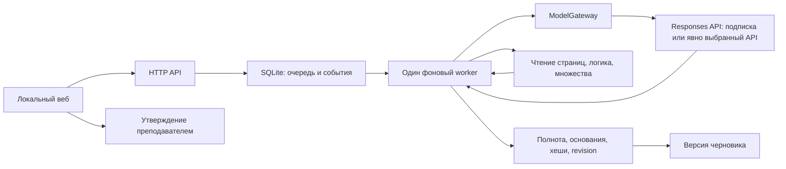

# GradeAI: помощник преподавателя

Агент проверяет письменные работы по дискретной математике: читает условие,
критерии и страницы решения, проверяет формулы и конечные множества, затем
готовит объяснимый черновик оценки. Преподаватель сверяет основания с оригиналом,
исправляет результат и утверждает его. Это полезно при проверке группы: рутинные
действия выполняются после одного запуска, спорные места остаются видны человеку.

## Запуск и демонстрационный курс

Требуется Python 3.11+.

```bash
python3 -m venv .venv
source .venv/bin/activate
python -m pip install -r requirements.txt
python scripts/demo.py
```

Откройте <http://127.0.0.1:8766>. Будут созданы отдельная база `data/demo/`,
одно ДЗ и три учебные работы. Основная база `data/reviewer.sqlite3` не используется.
Демонстрационные PDF хранятся в `demo/`; их можно передавать вместе с кодом.
Для повторяемой генерации PDF нужен Arial Unicode или DejaVu Sans. На Linux
подходит пакет `fonts-dejavu-core`. Иной TTF задаётся через `REVIEWER_DEMO_FONT`.

Повторный запуск сохраняет демобазу. Для нового чистого курса задайте другую папку:

```bash
python scripts/demo.py --data-dir data/demo-fresh --port 8767
```

### Подключение настоящей модели

1. Откройте вкладку «Агент», режим «Подписка ChatGPT».
2. Нажмите **Continue with ChatGPT** и завершите официальный вход. Дайте разрешение
   использовать план. Вход сам по себе не означает, что это разрешение выдано.
3. Вернувшись, нажмите «Получить список», выберите доступную модель и сохраните режим.
4. Нажмите «Проверить подключение»: модель должна прочитать цифру на изображении,
   вызвать инструмент и использовать выданную им случайную квитанцию. Оба запроса
   должны завершиться `response.completed`.
5. Во вкладке «Работы» отметьте работы и нажмите «Проверить выбранные».

Командная проверка того же подключения:

```bash
python scripts/smoke_model.py --data-dir data/demo
```

Подписочный путь реализован по официальным руководствам
[Registration and sign-in](https://developers.openai.com/siwc/token-sharing-open-source/sign-in),
[Models and inference](https://developers.openai.com/siwc/token-sharing-open-source/models-and-inference)
и [Preview limitations](https://developers.openai.com/siwc/token-sharing-open-source/preview-limitations).
Доступ конкретного аккаунта подтверждается только успешной живой проверкой.
Локальное использование плана не даёт автоматически разрешения на публичный сервис
для других пользователей.

### Отдельный платный API

Задайте `OPENAI_API_KEY` в окружении процесса сервера, перезапустите приложение и
явно выберите режим «OpenAI API · отдельная оплата». Ключ в веб-форму не вводится.
Настройка `.env` сама по себе не загружается. При лимите или ошибке подписки
приложение не переключает способ оплаты.

### Проверка интерфейса без LLM

Только при запуске через `scripts/demo.py` доступен режим «Сценарная проверка · без LLM».
Он исполняет настоящие инструменты чтения PDF, таблицы истинности и вычисления
множеств, но следующий вызов выбирает предопределённый сценарий. В интерфейсе,
журнале и комментарии преподавателю это явно обозначено. Этот режим подходит
для проверки UI и записи интерфейсного walkthrough; им нельзя подтверждать
работоспособность модели или качество автоматического оценивания.

## Сценарий скринкаста

Шкала задаётся отдельно для каждой задачи в карточке ДЗ: `1 | Название | а, б | 10`.
Четвёртое поле — максимальный целый балл (1–100); если его нет, используется 4.
Пятое необязательное поле задаёт максимумы подпунктов в том же порядке:
`1 | Монеты | a, b | 10 | 5, 5`. Тогда черновик содержит отдельные баллы подпунктов,
а валидатор проверяет их границы и совпадение суммы с баллом задачи.
Агент получает шкалу из контекста, сервер проверяет границы и считает сумму.
Изменение шкалы требует новой проверки, как и изменение условия или критериев.
Перечень задач задаёт охват проверки: дополнительные задания из PDF не оцениваются,
если их нет в перечне. Эталонное решение необязательно; критерии обязательны.

Для сдачи включите настоящую модель и покажите не только итог:

1. Карточка ДЗ: условие, критерии, две задачи. Откройте исходные материалы.
2. Запуск трёх работ и журнал: чтение → проверка → выбор дальнейшего инструмента.
3. Анна: корректные ответы, ожидаемый черновик 8/8.
4. Борис: агент проверяет равносильность конъюнкции и дизъюнкции, получает
   контрпример `P=false, Q=false`, возвращается к фрагменту и объясняет ошибку.
   По критериям ожидается 0+4=4/8.
5. Вера: утраченный символ перечитывается с увеличением; ожидается запрос ручного
   чтения без числовой оценки. Правильный символ не следует угадывать.
6. Откройте оригинал рядом с обоснованиями, покажите историю версий, утвердите
   выбранный результат и экспортируйте CSV/XLSX.

Если реальная модель расходится с эталонным разбором, сохраните журнал и разберите
ошибку. Совпадение на трёх работах не является измерением точности на реальном курсе.

## Архитектура и границы доступа



- `model_gateway.py`: OAuth с PKCE/state/nonce, проверка подписи ID token и scopes,
  каталог моделей, SSE до терминального события, нормализованные ошибки.
- `review_agent.py` и `agent_tools.py`: цикл до 24 обращений к модели и 10 минут,
  ограниченные инструменты, повторная попытка после ошибки валидации. Один запуск
  соответствует одной работе; весь пакет не смешивается в одном контексте.
- `review_storage.py`: проверки полного результата, снимок SHA-256 исходников,
  неизменяемые версии и атомарное сохранение с ожидаемой ревизией.

Инструменты получают только идентификаторы источников текущей работы. Модель
не получает shell, произвольный доступ к файлам, SQL, утверждение оценок или
учётные данные. Работа студента считается данными, а не инструкцией агенту.
TeX читается как текст, его команды не выполняются. Страница PDF передаётся модели
изображением и извлечённым текстом; перед финальным черновиком проверяется покрытие
всех страниц работы, условия и критериев. История других студентов не передаётся.

OAuth credentials находятся вне репозитория в `~/.config/homework-reviewer/`,
атомарно записываются с правами `0600`. Refresh сериализован файловой блокировкой.
Сохранённые подключения можно выбирать и повторно подключать через интерфейс.
Отзыв сессии выполняется официальным endpoint; при отсутствии подтверждения
удалённого отзыва это явно сообщается. Токены не возвращаются через HTTP API.

## Интерфейсы и данные

- `POST /api/agent/runs` — `{ "review_ids": ["..."] }`, возвращает принятые запуски.
- `GET /api/agent/runs?homework_id=...` — последние запуски выбранного ДЗ.
- `GET /api/agent/runs/{id}?after={seq}` — состояние и следующая порция событий.
- `POST /api/agent/runs/{id}/cancel` — остановка без сохранения нового результата.
- `GET /api/records/{id}/versions` — полные сохранённые версии.
- `GET /api/records/{id}/pages` и `/page?page=1` — число страниц и изображение страницы.
- `/api/model/status`, `/models`, `/config`, `/probe` и `/auth/*` — настройка модели.

В карточке ДЗ добавлены `rubric_path` и `problems`:

Автоматическая проверка первой версии принимает один полный PDF на студента.
Многочастные работы сначала собираются существующим скриптом из `docs/pdf-assembly.md`.
TeX и отдельные изображения остаются доступны для ручной работы.

```json
{"problems":[{"problem":1,"title":"Логика","subparts":["а","б"]}]}
```

Для нового автоматического результата каждая оценка содержит `problem`, `score`,
`page`, `reason` и `subparts: [{"id":"а","reason":"..."}]`. Глобальные основания
`evidence: [{"source":"work","page":1,"note":"..."}]` должны ссылаться на
прочитанные страницы. Для задач без подпунктов передаётся пустой список.
Пропущенная задача, лишняя задача, пустое обоснование, дробный балл или
непрочитанный источник блокируют результат. Сумму вычисляет сервер.

Старые карточки без перечня задач остаются доступны для ручной работы. Для запуска
агента нужно заполнить спецификацию, условие и критерии. Добавляются столбцы
`revision`, `provenance_json` и таблицы `review_versions`, `agent_runs`, `agent_events`.
Существующие записи сохраняются; перед первой правкой сохраняется полный снимок.
Правка из устаревшего окна получает HTTP 409. После изменения исходников утверждение
старого результата блокируется. Активный запуск на ту же работу второй раз не ставится.

После перезапуска сервера выполнявшиеся запуски помечаются прерванными; ожидающие
продолжают очередь. Остановка не удаляет ранее сохранённый черновик. Сетевая отмена
обрабатывается при получении очередного события или срабатывании сетевого timeout;
сохранение после запроса отмены блокируется в транзакции.

Для Responses отдельно заданы ожидание данных 180 с, передача изображений 60 с и
подключение 10 с. Таймаут, транспортный обрыв или незавершённый поток повторяются
не более двух раз с паузами 1 и 2 с; повтор виден в журнале. Повторяется только
текущий запрос с прежним контекстом. Инструменты исполняются после полного
`response.completed`, поэтому незавершённая попытка не сохраняет оценку и не
повторяет выполненные инструменты. Ошибки авторизации и лимита завершают запуск
сразу. Для диагностики сохраняются категория сбоя и доступный `x-request-id`,
без токенов и содержимого транспортных исключений.

## Проверка установки

Живая проверка выполнена 13 ноября 2026 на `gpt-6.1-sol` через подписку ChatGPT.
Проверка подключения прошла все четыре этапа; реальные результаты трёх работ
совпали с разбором: 8/8, 4/8, запрос ручного чтения без оценки. В ошибочной работе
агент вызвал таблицу истинности, получил контрпример и повторно открыл страницу.
Платный API при этом был выключен. Это проверка данного демонстрационного набора,
а не оценка точности на других работах.

Локальные артефакты: `output/demo/live-agent.webm` (запись настоящего запуска),
`live-verification.json` (результаты), `live-events.json` (вызовы инструментов).
Каталог `output/` исключён из Git; при передаче его нужно приложить отдельно.

```bash
python -m pip install -r requirements-pdf.txt
python -m unittest discover -s tests -v
```

Для двух тестов отдельного скрипта сборки PDF дополнительно нужен Poppler
(`brew install poppler` / `apt install poppler-utils`). Агент рендерит PDF через
PyMuPDF и не зависит от Poppler. Тесты математических инструментов, очереди,
валидации, гонок, OAuth и SSE используют временные базы и подставной транспорт.
Они не выполняют платных запросов и не заменяют живую проверку подключения.
